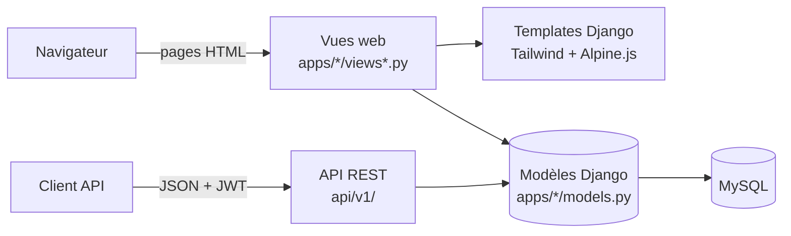
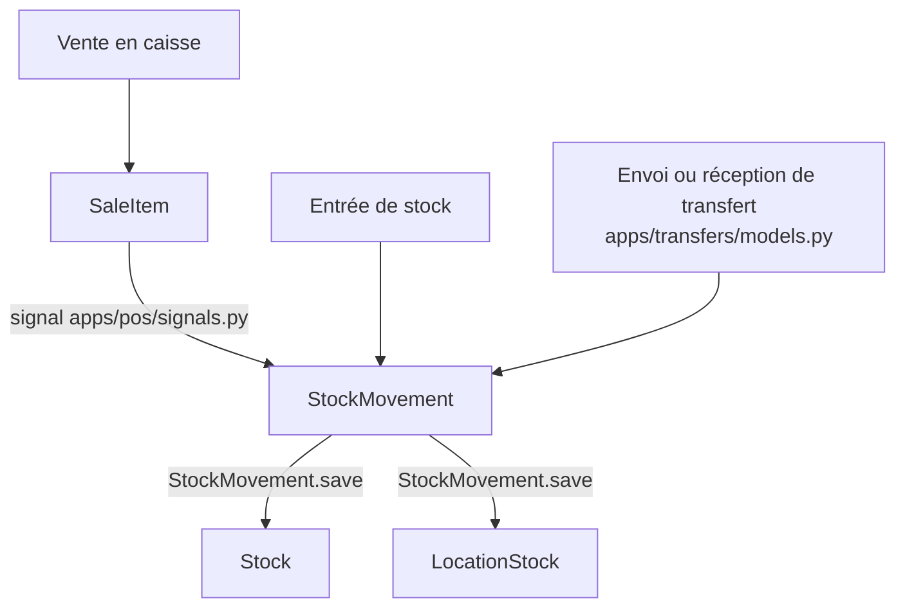

# Architecture du projet

Ce document est la carte du projet : il explique comment le backend et le frontend sont organisés, et où aller pour modifier quelque chose. Pour installer le projet, voir [README.fr.md](README.fr.md).

## Vue d'ensemble

L'application est un **monolithe Django** : le même projet contient le backend, les pages web et l'API. Il n'y a pas d'application frontend séparée (ni React, ni étape de compilation).



Il y a donc **deux portes d'entrée vers les mêmes données** : les pages web et l'API. Corriger une règle métier dans une vue web ne la corrige pas dans l'API : vérifiez les deux.

| Couche | Technologie |
|---|---|
| Backend | Python, Django 5.0 |
| API | Django REST Framework, SimpleJWT, drf-spectacular (documentation) |
| Base de données | MySQL 8 en local (Docker), SQLite en mémoire pour les tests |
| Frontend | Templates Django, TailwindCSS et Alpine.js (chargés par CDN) |
| Exports | openpyxl (Excel), reportlab (PDF) |

## Organisation des dossiers

```
stock_control/      Configuration Django : settings.py, settings_test.py, urls.py
apps/               Le code métier, une application par domaine
api/v1/             L'API REST : views/, serializers/, permissions.py, auth/, urls.py
templates/          Templates communs : base.html, login.html, home.html, dashboards/, partials/
tests/              Tests pytest, factories.py et conftest.py
docs/               Schéma de la base de données et guide fonctionnel
manage.py           Commandes Django
docker-compose.yml  Base MySQL locale
```

## Backend

### Les applications (`apps/`)

| Application | Rôle | Modèles |
|---|---|---|
| `core` | Entreprise, modèles de base, tableaux de bord, exports | `Enterprise`, `EnterpriseAwareModel`, `TimeStampedModel`, `AuditableModel` |
| `accounts` | Utilisateurs, rôles, journal d'actions | `User`, `ActionLog` |
| `products` | Catalogue | `Category`, `Product`, `ProductPackaging` |
| `stock` | Niveaux de stock et mouvements | `Stock`, `StockMovement` |
| `locations` | Dépôts et boutiques | `LocationType`, `Location`, `LocationStock` |
| `transfers` | Transferts entre emplacements | `Transfer`, `TransferItem` |
| `pos` | Caisse et ventes | `Sale`, `SaleItem` |
| `customers` | Clients et crédits | `Customer`, `CustomerCredit`, `CreditPayment` |
| `accounting` | Dépenses et caisse | `ExpenseCategory`, `Expense`, `CashRegisterSession`, `DailySummary` |
| `reports` | Rapports et exports Excel | Aucun modèle |
| `settings` | Paramètres du magasin | `StoreSetting` |

Une application contient en général :

```
apps/<nom>/
├── models.py        Tables de la base de données
├── views.py         Vues web
├── urls.py          Adresses des pages
├── admin.py         Interface d'administration Django
├── signals.py       Automatismes (pos et customers uniquement)
├── templates/<nom>/ Pages HTML de cette application
├── migrations/      Évolutions de la base de données
└── management/commands/  Commandes personnalisées
```

**Attention :** dans `pos` et `stock`, les vues web sont dans `views_frontend.py`. Le fichier `views.py` y est pratiquement vide.

### Le cœur du système : le stock

C'est la règle la plus importante à comprendre : **on ne modifie jamais une quantité de stock directement. On crée un `StockMovement`.**

`StockMovement.save()` (`apps/stock/models.py`) met à jour automatiquement deux tables : `Stock` et `LocationStock`. Ainsi, tous les écrans affichent les mêmes chiffres.



### Les automatismes (signaux)

| Fichier | Déclencheur | Effet |
|---|---|---|
| `apps/pos/signals.py` | Création d'un `SaleItem` | Crée le mouvement de stock |
| `apps/pos/signals.py` | Changement de statut d'une `Sale` | Gère les conséquences sur le stock et journalise l'action |
| `apps/customers/signals.py` | Enregistrement d'une `Sale` | Met à jour les statistiques du client et crée le `CustomerCredit` pour une vente à crédit |
| `apps/customers/signals.py` | Enregistrement d'un `Customer` | Valide la limite de crédit |

Ne créez donc pas de `CustomerCredit` à la main pour une vente à crédit : vous auriez un doublon.

### Multi-entreprise et emplacements

- La plupart des données sont liées à une `Enterprise` : chaque utilisateur ne doit voir que celles de son entreprise.
- Certains rôles, comme le caissier et le gérant de boutique, sont aussi limités à leur emplacement (`user.location`).
- Dans l'API, les classes de `apps/core/mixins.py` servent à appliquer ce filtrage.

Pour toute nouvelle vue, filtrez explicitement par entreprise.

### Les rôles

| Rôle | Accès | Page d'accueil |
|---|---|---|
| `admin`, `owner` | Tout | `/dashboard/patron/` |
| `manager`, `boutique_manager` | Gestion | `/dashboard/gerant/` |
| `warehouse_manager`, `stock_manager` | Stock et transferts | Tableau de bord du stock |
| `cashier` | Caisse et clients | `/dashboard/caisse/` |
| `accountant` | Lecture et rapports | `/dashboard/comptable/` |

La redirection selon le rôle est dans `apps/core/dashboard_views.py`. Les permissions de l'API sont dans `api/v1/permissions.py`.

### L'API REST (`api/v1/`)

- **Routes :** `api/v1/urls.py` déclare toutes les ressources (`products`, `sales`, `stock-movements`, etc.).
- **Connexion :** `api/v1/auth/` (JWT), par exemple `POST /api/v1/auth/login/`.
- **Documentation interactive :** http://127.0.0.1:8000/api/v1/docs/
- **Logique :** `views/` (ce que fait chaque ressource) et `serializers/` (conversion et validation du JSON).

### Conventions des modèles

- **Argent :** `DecimalField(max_digits=12, decimal_places=2)`
- **Quantités :** `DecimalField(max_digits=12, decimal_places=3)`, pour gérer les kg et les litres
- **Suppression :** logique avec `is_active`. On ne supprime jamais réellement un produit ou un client.
- **Ventes :** `SaleItem` conserve le nom et le prix au moment de la vente

## Frontend

Les pages sont générées côté serveur par Django, puis envoyées au navigateur.

### Comment une page est construite

```
Adresse demandée   /stock/low-stock/
      ↓
stock_control/urls.py   /stock/ est envoyé vers apps/stock/urls.py
      ↓
apps/stock/urls.py      low-stock/ est envoyé vers une vue
      ↓
apps/stock/views_frontend.py    La vue lit les données et choisit un template
      ↓
apps/stock/templates/stock/...  Le template hérite de templates/base.html
```

### Où sont les templates

| Emplacement | Contenu |
|---|---|
| `templates/base.html` | Structure commune : menu latéral, en-tête, chargement de Tailwind et Alpine.js |
| `templates/login.html` | Page de connexion |
| `templates/home.html` | Page d'accueil par défaut |
| `templates/dashboards/` | Tableaux de bord `patron`, `gerant`, `caisse`, `comptable` et cartes `_kpi` |
| `templates/partials/export_buttons.html` | Boutons d'export PDF et Excel |
| `apps/<nom>/templates/<nom>/` | Pages propres à chaque application |

### Les outils

- **TailwindCSS :** le style, directement avec des classes dans le HTML. Il n'y a rien à compiler.
- **Alpine.js :** les petites interactions, avec les attributs `x-data`, `x-show`, etc.
- **`fetch()` :** les appels sans rechargement. La caisse (`apps/pos/templates/pos/cashier.html`) l'utilise pour rechercher les produits, créer un client et enregistrer une vente.

Tailwind et Alpine.js sont chargés depuis Internet : sans connexion, les pages s'affichent sans style.

### Les pages

| Adresse | Page | Code |
|---|---|---|
| `/login/` | Connexion | `templates/login.html` |
| `/` | Redirection vers le tableau de bord du rôle | `apps/core/dashboard_views.py` |
| `/dashboard/patron/`, `gerant/`, `caisse/`, `comptable/` | Tableaux de bord par rôle | `apps/core/` |
| `/pos/` | Caisse | `apps/pos/` |
| `/pos/sales/` | Historique des ventes | `apps/pos/` |
| `/products/` | Produits et catégories | `apps/products/` |
| `/stock/` | Stock, entrées, stock faible, ruptures, mouvements | `apps/stock/` |
| `/locations/` | Dépôts et boutiques | `apps/locations/` |
| `/transfers/` | Transferts | `apps/transfers/` |
| `/customers/` | Clients et crédits | `apps/customers/` |
| `/accounting/expenses/`, `/accounting/cash-sessions/` | Dépenses et sessions de caisse | `apps/accounting/` |
| `/reports/` | Rapports et exports | `apps/reports/` |
| `/accounts/users/` | Utilisateurs | `apps/accounts/` |
| `/guide/` | Guide fonctionnel | `docs/functional_documentation.html` |
| `/admin/` | Administration Django | `apps/*/admin.py` |

## Je veux modifier...

| Je veux... | Où aller |
|---|---|
| Ajouter un élément au menu | `templates/base.html` |
| Modifier la caisse | `apps/pos/views_frontend.py` et `apps/pos/templates/pos/cashier.html` |
| Modifier un tableau de bord | `apps/core/dashboard_views.py` et `templates/dashboards/` |
| Ajouter un champ à un produit | `apps/products/models.py`, puis les vues, les templates, `api/v1/serializers/products.py`, et enfin une migration |
| Changer la logique du stock | `apps/stock/models.py` |
| Changer ce qui se passe lors d'une vente | `apps/pos/signals.py` et `apps/customers/signals.py` |
| Ajouter un export PDF ou Excel à une liste | `apps/core/exports.py` et `templates/partials/export_buttons.html` |
| Modifier les rapports Excel | `apps/reports/utils/excel_generator.py` |
| Ajouter une ressource à l'API | `api/v1/views/`, `api/v1/serializers/`, puis `api/v1/urls.py` |
| Changer une permission de l'API | `api/v1/permissions.py` |

## Tests

Les tests sont dans `tests/` et utilisent SQLite en mémoire (`stock_control/settings_test.py`) : ils n'ont pas besoin de Docker.

| Fichier | Ce qu'il couvre |
|---|---|
| `tests/test_api.py` | API REST |
| `tests/test_models.py` | Modèles |
| `tests/test_views.py` | Vues web |
| `tests/test_forms_e2e.py` | Formulaires |
| `tests/test_ui_navigation.py` | Navigation |
| `tests/test_role_dashboards.py` | Tableaux de bord par rôle |
| `tests/test_multilocation_inventory.py` | Stock multi-emplacements |
| `tests/test_locations_crud.py` | Gestion des emplacements |
| `tests/test_product_list_locations.py` | Listes de produits par emplacement |
| `tests/test_stock_entry_dropdown.py` | Formulaire d'entrée de stock |
| `tests/test_import_catalog.py` | Import du catalogue (a besoin du fichier Excel du client) |

- `tests/factories.py` crée des données de test.
- `tests/conftest.py` fournit des clients déjà connectés : `admin_client`, `manager_client`, `cashier_client`, `stock_manager_client`.

Évitez le SQL propre à MySQL dans le code, car il ne fonctionne pas avec SQLite pendant les tests.

## Commandes utiles

| Commande | Usage |
|---|---|
| `python manage.py makemigrations` | Crée une migration après une modification de modèle |
| `python manage.py migrate` | Applique les migrations |
| `python manage.py seed_data` | Crée les catégories de dépenses et les paramètres |
| `python manage.py seed_full_data` | Crée une entreprise de démonstration complète |
| `python manage.py generate_daily_summary` | Calcule le résumé journalier |

## Pour aller plus loin

- [README.fr.md](README.fr.md) : installation
- [docs/database_schema.md](docs/database_schema.md) : schéma complet de la base de données
- [docs/design_decisions.md](docs/design_decisions.md) : choix de conception
- [API_QUICK_REFERENCE.md](API_QUICK_REFERENCE.md) : points d'accès de l'API
- `docs/functional_documentation.html` : guide d'utilisation, aussi disponible sur `/guide/`

Certains documents plus anciens à la racine (`BATCH*`, `CURSOR_*`, `PROJECT_STATUS.md`) sont des rapports historiques et peuvent ne plus correspondre au code. En cas de doute, le code fait foi.
