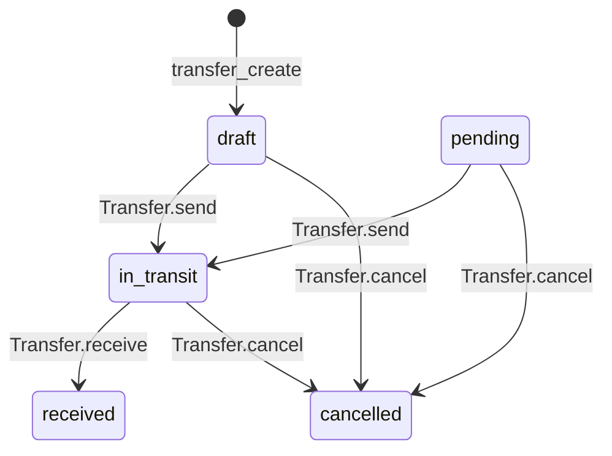

# Transferts

Un transfert déplace du stock d'un emplacement à un autre, par exemple d'un dépôt vers une boutique. Il suit plusieurs étapes, car la marchandise quitte la source avant d'arriver à destination. Les rôles de stock et de gestion l'utilisent, et le rôle `accountant` le consulte.

## Sommaire

- [Cycle de vie et statuts](#cycle-de-vie-et-statuts)
- [Liste des transferts](#liste-des-transferts)
- [Créer un transfert](#créer-un-transfert)
- [Détail d'un transfert](#détail-dun-transfert)
- [Envoyer un transfert](#envoyer-un-transfert)
- [Réceptionner un transfert](#réceptionner-un-transfert)
- [Annuler un transfert](#annuler-un-transfert)
- [Transferts dans l'administration Django](#transferts-dans-ladministration-django)
- [À retenir](#à-retenir)

## Cycle de vie et statuts

**Ce que voit l'utilisateur :** un badge de statut sur chaque transfert. Les boutons disponibles dépendent de ce statut. Le parcours normal est : création, envoi, réception.

| Statut | Libellé | Effet sur le stock en arrivant à ce statut | Actions possibles |
|---|---|---|---|
| `draft` | Brouillon | Aucun | Envoyer, annuler |
| `pending` | En attente | Aucun | Envoyer, annuler |
| `in_transit` | En transit | Sortie `transfer_out` à la source | Réceptionner, annuler |
| `received` | Reçu | Entrée `transfer_in` à la destination | Aucune |
| `cancelled` | Annulé | Entrée `correction` à la source, seulement depuis `in_transit` | Aucune |

**Ce qui se passe dans le code :**

1. `Transfer.STATUS_CHOICES` (`apps/transfers/models.py`) définit les statuts. `Transfer.status` vaut `draft` par défaut.
2. Chaque action a une vue dans `apps/transfers/views.py`, qui appelle une méthode du modèle.
3. `Transfer.send()`, `Transfer.receive()` et `Transfer.cancel()` vérifient le statut, créent les `StockMovement` et changent le statut.
4. `StockMovement.save()` met à jour `Stock` et `LocationStock`. Voir [le guide du stock](04-stock.md).
5. Les boutons de `apps/transfers/templates/transfers/detail.html` dépendent du statut.

**Où le trouver :**

| Élément | Fichier | Fonction ou classe |
|---|---|---|
| Transfert | `apps/transfers/models.py` | `Transfer` |
| Ligne d'article | `apps/transfers/models.py` | `TransferItem` |
| Changements de statut | `apps/transfers/models.py` | `Transfer.send()`, `Transfer.receive()`, `Transfer.cancel()` |
| Mise à jour du stock | `apps/stock/models.py` | `StockMovement.save()` |
| API | `api/v1/views/transfers.py` | `TransferViewSet` |

**Règles à connaître :**

- Pendant `in_transit`, la quantité a quitté la source et n'est pas encore à destination. Le total du produit, tous lieux confondus, baisse donc jusqu'à la réception.
- Aucun code de `apps/transfers/views.py` ni de `apps/transfers/models.py` ne pose le statut `pending`. Un transfert créé par le web commence à `draft`. `pending` ne s'obtient qu'en saisissant le statut dans l'administration Django ou par l'API.
- Les rôles indiqués dans ce guide valent pour les pages web. L'API a ses propres permissions : voir [le guide de l'API](11-api-rest.md).
- Il n'existe aucune route web pour modifier ou supprimer un transfert. Pour corriger un brouillon, on l'annule et on en crée un autre.
- `Transfer.send()`, `Transfer.receive()` et `Transfer.cancel()` n'ouvrent pas de transaction. Une erreur au milieu peut laisser une partie des mouvements enregistrés.

**Pour le tester :** en `manager`, suivez un transfert de bout en bout avec les sections suivantes. Consultez `stock:movements` après chaque étape : une ligne s'ajoute par article à l'envoi et à la réception.

## Liste des transferts

**Ce que voit l'utilisateur :** un tableau avec la référence, la source, la destination, le nombre d'articles, le statut et la date. Deux pastilles indiquent les transferts en attente et en transit, quand leur nombre n'est pas nul. Il peut filtrer par statut et par emplacement, et exporter.

**Ce qui se passe dans le code :**

1. `/transfers/` est déclarée sous le nom `transfers:list` dans `apps/transfers/urls.py` et appelle `transfer_list()`.
2. La vue contrôle le rôle avec `TRANSFER_VIEW_ROLES`, puis charge les `Transfer` de l'entreprise.
3. Elle applique `?status=`, `?location=` (source ou destination), `?source=` et `?destination=`.
4. `export_list_response()` renvoie le fichier si `?export=` est présent.
5. Elle calcule les deux compteurs et transmet au plus 50 transferts.
6. `apps/transfers/templates/transfers/list.html` affiche le tableau. `Transfer.total_items` donne le nombre d'articles.

**Où le trouver :**

| Élément | Fichier | Fonction ou classe |
|---|---|---|
| URL `transfers:list` | `apps/transfers/urls.py` | `transfer_list()` |
| Vue | `apps/transfers/views.py` | `transfer_list()` |
| Modèle | `apps/transfers/models.py` | `Transfer` |
| Export | `apps/core/exports.py` | `export_list_response()` |
| Template | `apps/transfers/templates/transfers/list.html` | Aucune |
| Lien de menu | `templates/base.html` | Aucune |

**Règles à connaître :**

- Rôles autorisés : `admin`, `owner`, `manager`, `warehouse_manager`, `boutique_manager`, `stock_manager`, `accountant`.
- L'entrée de menu « Transferts » n'apparaît que pour `admin`, `owner`, `manager`, `warehouse_manager` et `boutique_manager`.
- Le bouton « Nouveau Transfert » ne s'affiche pas pour `accountant`, qui reste en lecture seule.
- L'écran montre 50 transferts au plus, sans pagination. Un export peut en contenir 5000.
- `?source=` et `?destination=` n'ont pas de champ dans le formulaire. Le lien « Recevoir » de `locations:detail` utilise `?destination=`. Aucun lien n'utilise `?source=` sur cette liste.
- Les compteurs suivent les filtres actifs.

**Pour le tester :** en `accountant`, ouvrez `/transfers/`. La liste s'affiche sans le bouton « Nouveau Transfert ». Filtrez sur « En transit » : seuls ces transferts restent.

## Créer un transfert

**Ce que voit l'utilisateur :** il choisit une source et une destination, puis ajoute des lignes d'articles avec le bouton « Ajouter », et peut saisir des notes. Chaque ligne a une recherche de produit et une quantité, et une corbeille s'il y a plusieurs lignes. La recherche ne propose que les produits en stock à la source, avec leur quantité disponible. Le bouton de création reste désactivé tant que le formulaire n'est pas valide.

**Ce qui se passe dans le code :**

1. `/transfers/create/` est déclarée sous le nom `transfers:create` et appelle `transfer_create()`.
2. En GET, la vue lit `?source=` et `?product=` pour présélectionner la source et le premier article.
3. Elle construit `stock_map` à partir de `LocationStock`, puis `products_json`. Chaque produit y porte son libellé, son unité et son stock par emplacement.
4. Dans `apps/transfers/templates/transfers/create.html`, `transferForm()` crée l'état Alpine.js.
5. `availableProducts()` garde les produits dont `stockAt()` est positif à la source, puis filtre sur le texte saisi. `selectProduct()` retient le choix dans le champ caché `product_id`.
6. `stockFor()` donne le maximum du champ quantité. `qtyValid()` et `isValid()` activent le bouton. `updateProducts()` retire les produits sans stock si la source change.
7. En POST, la vue vérifie les deux emplacements et que la source diffère de la destination.
8. Elle contrôle chaque ligne contre `LocationStock` à la source, avant de créer quoi que ce soit.
9. Elle crée le `Transfer` en `draft`. À cet enregistrement, `Transfer.save()` génère la référence au format `TRF-AAAAMMJJ-XXXX`.
10. Elle crée un `TransferItem` par ligne, et redirige vers `transfers:detail`.

**Où le trouver :**

| Élément | Fichier | Fonction ou classe |
|---|---|---|
| URL `transfers:create` | `apps/transfers/urls.py` | `transfer_create()` |
| Vue | `apps/transfers/views.py` | `transfer_create()` |
| Référence | `apps/transfers/models.py` | `Transfer.save()` |
| Modèle des lignes | `apps/transfers/models.py` | `TransferItem` |
| Stock lu | `apps/locations/models.py` | `LocationStock` |
| Recherche de produit | `apps/transfers/templates/transfers/create.html` | `transferForm()`, `availableProducts()` |

**Règles à connaître :**

- Rôles autorisés : `admin`, `owner`, `manager`, `warehouse_manager`, `boutique_manager`, `stock_manager`. L'utilisateur doit être rattaché à une entreprise.
- Créer un transfert ne déplace aucun stock et ne réserve aucune quantité. Le stock est de nouveau contrôlé à l'envoi.
- La recherche porte sur le libellé (nom et catégorie), pas sur le SKU ni sur le code-barres.
- Seuls les produits actifs de l'entreprise sont proposés. Un produit global, sans entreprise, ne l'est pas.
- Si une quantité dépasse le stock, le serveur refuse tout le transfert et revient à un formulaire vide.
- Les lignes dont le produit ou la quantité est invalide sont ignorées sans message. Si aucune ligne n'est valide, le message « Aucun article valide dans le transfert. » apparaît.
- Un même produit ne doit figurer que sur une ligne, à cause de la contrainte `unique_together` de `TransferItem`. Le formulaire ne l'empêche pas : deux lignes identiques provoquent une erreur serveur et laissent un brouillon incomplet.

**Pour le tester :** en `warehouse_manager`, ouvrez `/transfers/create/`. La recherche est désactivée. Choisissez une source : seuls ses produits en stock apparaissent, avec leur quantité. Saisissez une quantité trop grande : le champ devient rouge et le bouton reste désactivé.

## Détail d'un transfert

**Ce que voit l'utilisateur :** la référence, le statut, le trajet, les articles, un historique daté avec les auteurs de chaque étape, et les notes. Après la réception, le tableau ajoute la quantité reçue et l'écart. Les boutons d'action sont en haut.

**Ce qui se passe dans le code :**

1. `/transfers/<pk>/` est déclarée sous le nom `transfers:detail` et appelle `transfer_detail()`.
2. La vue contrôle le rôle, puis vérifie que le transfert appartient à l'entreprise de l'utilisateur.
3. Elle charge les `TransferItem` et calcule `can_manage_transfers`.
4. `apps/transfers/templates/transfers/detail.html` affiche la page, les boutons selon le statut et les deux fenêtres de réception et d'annulation.
5. `TransferItem.variance` calcule l'écart entre le reçu et l'envoyé.

**Où le trouver :**

| Élément | Fichier | Fonction ou classe |
|---|---|---|
| URL `transfers:detail` | `apps/transfers/urls.py` | `transfer_detail()` |
| Vue | `apps/transfers/views.py` | `transfer_detail()` |
| Écart | `apps/transfers/models.py` | `TransferItem.variance` |
| Template | `apps/transfers/templates/transfers/detail.html` | Aucune |

**Règles à connaître :**

- Rôles autorisés : les mêmes que pour `transfers:list`.
- Le bloc Actions ne s'affiche que si `can_manage_transfers` est vrai et si le transfert n'est ni `received` ni `cancelled`.

**Pour le tester :** ouvrez le même brouillon en `accountant`, puis en `manager`. Le premier ne voit aucun bouton d'action, le second les voit.

## Envoyer un transfert

**Ce que voit l'utilisateur :** un bouton « Envoyer », avec une confirmation qui annonce la déduction du stock à la source. Le statut devient « En transit ». L'historique affiche l'auteur et la date. En cas de stock insuffisant, un message d'erreur indique le produit et les quantités.

**Ce qui se passe dans le code :**

1. Le formulaire envoie un POST à `/transfers/<pk>/send/`, nommée `transfers:send`.
2. `transfer_send()` contrôle le rôle et l'entreprise, puis appelle `Transfer.send()`.
3. `Transfer.send()` refuse tout statut autre que `draft` ou `pending`.
4. La méthode vérifie d'abord tous les articles contre `LocationStock` à la source.
5. Elle crée un `StockMovement` par article : `exit`, raison `transfer_out`, référence du transfert.
6. `StockMovement.save()` diminue `Stock` et `LocationStock` à la source.
7. La méthode passe le statut à `in_transit` et remplit `sent_at` et `sent_by`.
8. La vue affiche le résultat et redirige vers `transfers:detail`.

**Où le trouver :**

| Élément | Fichier | Fonction ou classe |
|---|---|---|
| URL `transfers:send` | `apps/transfers/urls.py` | `transfer_send()` |
| Vue | `apps/transfers/views.py` | `transfer_send()` |
| Logique | `apps/transfers/models.py` | `Transfer.send()` |
| Mise à jour du stock | `apps/stock/models.py` | `StockMovement.save()` |
| API | `api/v1/views/transfers.py` | `TransferViewSet.send()` |

**Règles à connaître :**

- Rôles autorisés : `admin`, `owner`, `manager`, `warehouse_manager`, `boutique_manager`, `stock_manager`.
- L'action ne se fait qu'en POST. En GET, la vue revient simplement au détail.
- Le stock de la source peut avoir baissé depuis la création. Dans ce cas, l'envoi est refusé et aucun mouvement n'est créé.
- Le message d'erreur s'affiche entre crochets et apostrophes, par exemple `['Stock insuffisant pour ...']`, car la vue affiche `str(e)`.

**Pour le tester :** en `manager`, notez le stock source d'un produit, puis envoyez un brouillon de 5 unités. `locations:stock` affiche 5 unités de moins à la source, et rien de plus à la destination.

## Réceptionner un transfert

**Ce que voit l'utilisateur :** un bouton « Réceptionner » ouvre une fenêtre avec une ligne par article. La quantité envoyée y est préremplie et reste modifiable. Après la confirmation, le statut devient « Reçu » et le tableau montre la quantité reçue et l'écart.

**Ce qui se passe dans le code :**

1. Le formulaire envoie un POST à `/transfers/<pk>/receive/`, nommée `transfers:receive`, avec les champs `received_qty_<id>`.
2. `transfer_receive()` contrôle le rôle et l'entreprise.
3. Pour chaque article, elle enregistre `TransferItem.received_quantity` si le champ est rempli. Une valeur non numérique est ignorée.
4. Elle appelle `Transfer.receive()`, qui refuse tout statut autre que `in_transit`.
5. La méthode crée un `StockMovement` par article : `entry`, raison `transfer_in`, à la destination.
6. La quantité utilisée est `received_quantity` si elle est renseignée, sinon la quantité envoyée.
7. `StockMovement.save()` augmente `Stock` et `LocationStock` à la destination.
8. La méthode passe le statut à `received`, remplit `received_at` et `received_by`, puis la vue redirige vers `transfers:detail`.

**Où le trouver :**

| Élément | Fichier | Fonction ou classe |
|---|---|---|
| URL `transfers:receive` | `apps/transfers/urls.py` | `transfer_receive()` |
| Vue | `apps/transfers/views.py` | `transfer_receive()` |
| Logique | `apps/transfers/models.py` | `Transfer.receive()` |
| Quantité reçue et écart | `apps/transfers/models.py` | `TransferItem` |
| API | `api/v1/views/transfers.py` | `TransferViewSet.receive()` |

**Règles à connaître :**

- Rôles autorisés : `admin`, `owner`, `manager`, `warehouse_manager`, `boutique_manager`, `stock_manager`.
- Si la quantité reçue est plus petite que l'envoi, seule la quantité reçue entre en stock. La différence n'est pas rendue à la source : elle reste visible dans la colonne Écart.
- Une quantité reçue plus grande que l'envoi est acceptée. L'écart apparaît alors en positif.
- Une quantité reçue de 0 n'est pas traitée comme zéro. `Transfer.receive()` la remplace par la quantité envoyée, et la colonne « Quantité Reçue » affiche aussi cette quantité. La colonne Écart affiche pourtant la différence complète.

**Pour le tester :** en `boutique_manager`, réceptionnez un transfert de 5 unités en saisissant 4. La destination gagne 4 unités, et l'écart affiche -1.

## Annuler un transfert

**Ce que voit l'utilisateur :** un bouton « Annuler » ouvre une fenêtre qui demande une raison. Si le transfert est en transit, elle prévient que le stock retournera à la source. Le statut devient « Annulé » et la raison s'affiche dans l'historique.

**Ce qui se passe dans le code :**

1. Le formulaire envoie un POST à `/transfers/<pk>/cancel/`, nommée `transfers:cancel`, avec le champ `reason`.
2. `transfer_cancel()` contrôle le rôle et l'entreprise, puis appelle `Transfer.cancel()`.
3. `Transfer.cancel()` refuse les statuts `received` et `cancelled`.
4. Si le statut est `in_transit`, elle crée un `StockMovement` par article : `entry`, raison `correction`, à la source.
5. `StockMovement.save()` remet la quantité à la source.
6. La méthode passe le statut à `cancelled` et remplit `cancelled_at`, `cancelled_by` et `cancellation_reason`.
7. La vue affiche le résultat et redirige vers `transfers:detail`.

**Où le trouver :**

| Élément | Fichier | Fonction ou classe |
|---|---|---|
| URL `transfers:cancel` | `apps/transfers/urls.py` | `transfer_cancel()` |
| Vue | `apps/transfers/views.py` | `transfer_cancel()` |
| Logique | `apps/transfers/models.py` | `Transfer.cancel()` |
| API | `api/v1/views/transfers.py` | `TransferViewSet.cancel()` |
| Fenêtre d'annulation | `apps/transfers/templates/transfers/detail.html` | Aucune |

**Règles à connaître :**

- Rôles autorisés : `admin`, `owner`, `manager`, `warehouse_manager`, `boutique_manager`, `stock_manager`.
- Annuler un `draft` ou un `pending` ne crée aucun mouvement, car le stock n'a pas encore bougé.
- Le retour à la source a la raison `correction`, et non une raison de transfert. Il se retrouve dans `stock:movements` grâce à la référence du transfert.
- Le champ raison est requis dans le navigateur. Si `reason` est absent de la requête, la vue utilise le texte « Annulé par utilisateur ».
- Un transfert reçu ne peut pas être annulé.

**Pour le tester :** en `manager`, envoyez un transfert, puis annulez-le avec une raison. Le stock source revient à sa valeur de départ, et `stock:movements` affiche une entrée de raison `correction` avec la même référence.

## Transferts dans l'administration Django

**Ce que voit l'utilisateur :** un compte qui a `is_staff` trouve les transferts sous `/admin/transfers/transfer/`, avec des filtres et une recherche par référence ou par notes. Le menu d'actions de la liste propose « Envoyer les transferts sélectionnés » et « Recevoir les transferts sélectionnés ».

**Ce qui se passe dans le code :**

1. `TransferAdmin` (`apps/transfers/admin.py`) affiche les transferts. `TransferItemInline` affiche leurs lignes sur la même page.
2. `TransferAdmin.send_transfers()` garde les transferts cochés en `draft` ou `pending`, et appelle `Transfer.send()` pour chacun.
3. `TransferAdmin.receive_transfers()` garde ceux en `in_transit`, et appelle `Transfer.receive()` pour chacun.
4. Chaque action affiche un message par transfert, de succès ou d'erreur. Les transferts cochés qui ont un autre statut sont ignorés sans message.

**Où le trouver :**

| Élément | Fichier | Fonction ou classe |
|---|---|---|
| Liste et formulaire | `apps/transfers/admin.py` | `TransferAdmin` |
| Actions groupées | `apps/transfers/admin.py` | `TransferAdmin.send_transfers()`, `TransferAdmin.receive_transfers()` |
| Lignes seules | `apps/transfers/admin.py` | `TransferItemAdmin` |

**Règles à connaître :**

- Aucune action n'annule un transfert ici. L'annulation passe par `transfers:detail` ou par l'API.
- La réception groupée utilise `received_quantity` si elle est renseignée sur la ligne, sinon la quantité envoyée.
- Changer le champ `status` à la main dans le formulaire ne crée aucun `StockMovement`. Utilisez les actions pour que le stock suive.

**Pour le tester :** avec un compte qui a `is_staff`, cochez un brouillon dans `/admin/transfers/transfer/`, puis lancez « Envoyer les transferts sélectionnés ». Le statut passe à `in_transit`, et `stock:movements` affiche la sortie.

## À retenir

- Un transfert passe de `draft` à `in_transit`, puis à `received`. Il peut être `cancelled` avant la réception.
- Créer ne bouge pas le stock. Envoyer retire à la source, recevoir ajoute à la destination.
- Annuler un transfert en transit rend la quantité envoyée à la source avec une entrée `correction`.
- Toutes les variations passent par `StockMovement`. Les méthodes du modèle `Transfer` portent la logique, et les vues ne font que les appeler.
- Le stock disponible vient de `LocationStock`, contrôlé à la création et de nouveau à l'envoi.
